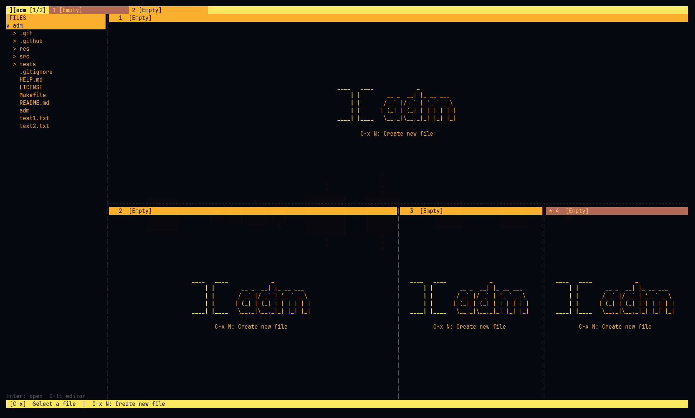

# ][adm

An opinionated, batteries-included text editor. It supports themes and plugins, but you probably won’t need them. Out of the box, ADM looks great and comes with a built-in file explorer, Git manager, a powerful integrated search tool (blazing fast), syntax highlighting, and LSP support.



## Overview

- **Emacs inspired controls**
- **Splits & Tabs**
- **File Explorer**
- **Git Manager**
- **Editing tools**
- **Syntax highlighting and LSP**
- **Configurable themes**
- **Plugins**

## Install

Linux and macOS:

```sh
curl -fsSL https://raw.githubusercontent.com/gslf/adm/main/install.sh | sh
```

Windows (PowerShell):

```powershell
powershell -ExecutionPolicy Bypass -c "irm https://raw.githubusercontent.com/gslf/adm/main/install.ps1 | iex"
```

The installers download the latest release for your platform, verify it against `SHA256SUMS.txt`, and add `adm` to your PATH. On Linux and macOS, adm is installed in `~/.local/share/adm` with a link in `~/.local/bin`; on Windows, in `%LOCALAPPDATA%\Programs\adm`. Run the same command again to upgrade. Set `ADM_VERSION=v1.3.0` to pick a release, `ADM_INSTALL_DIR` to change the location, or `ADM_NO_MODIFY_PATH=1` to leave the PATH alone; `install.sh` also accepts `sh -s -- --version <tag> --dir <path> --bin-dir <path> --no-modify-path`.

## Build and run

```sh
make
./adm [file | directory]
make test
```

Requires a C11 compiler and Git 2.23+ for Git features. Tests require Python 3 and Git, using temporary repositories and local remotes; POSIX tests also cover the terminal UI. Clean with `make clean`.

Read the [user guide and keyboard shortcuts](HELP.md) for editor usage.
